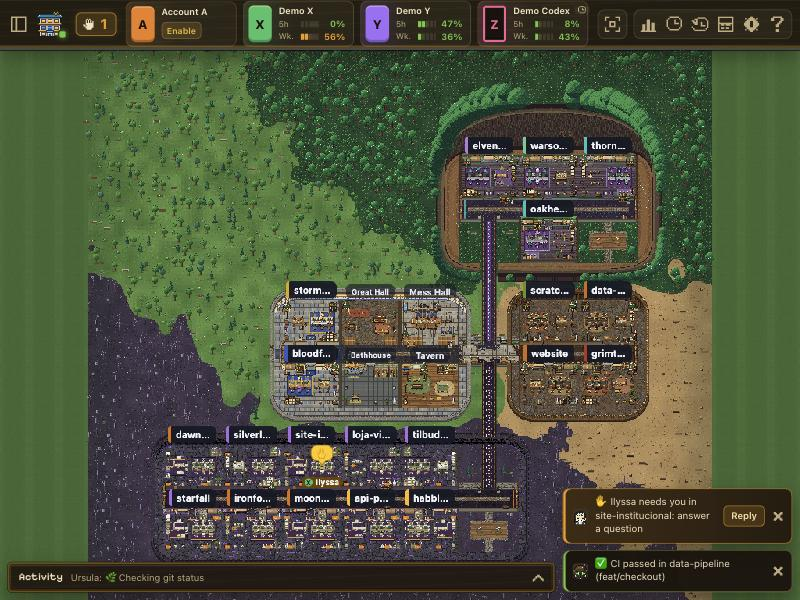
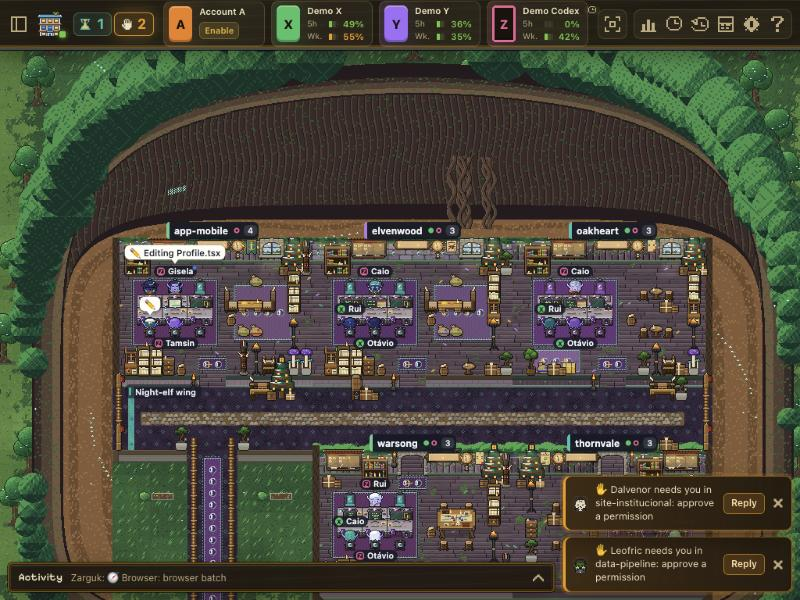
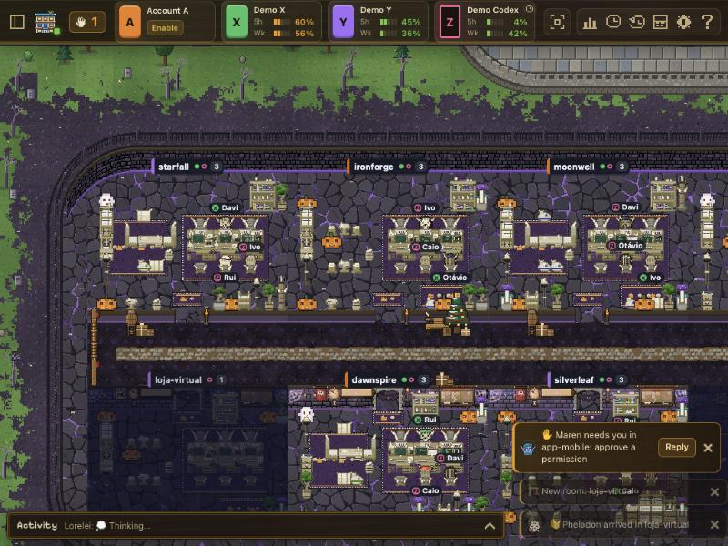
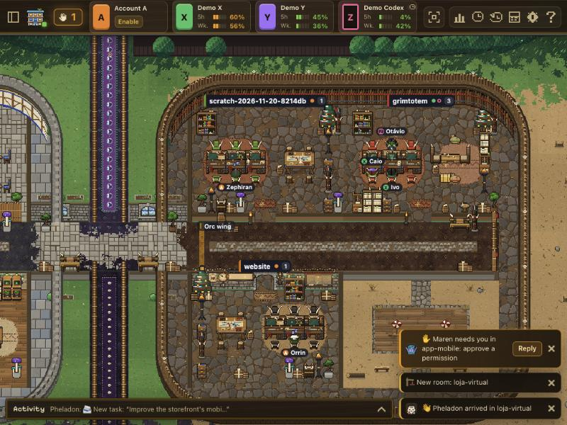
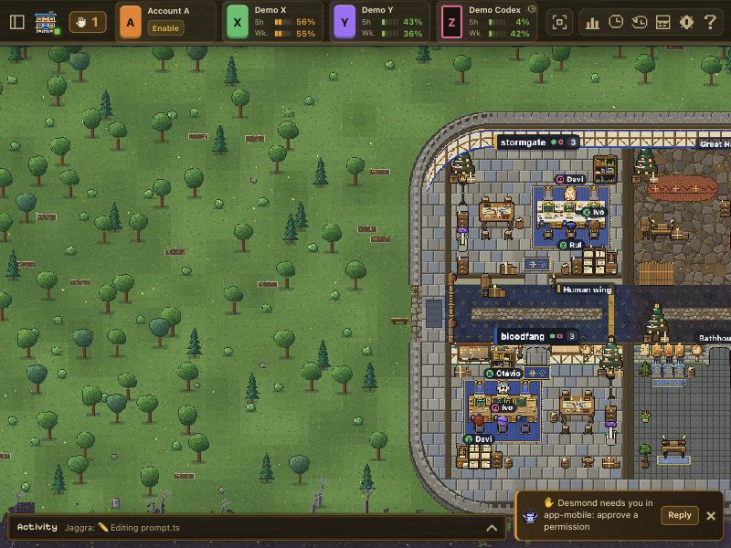
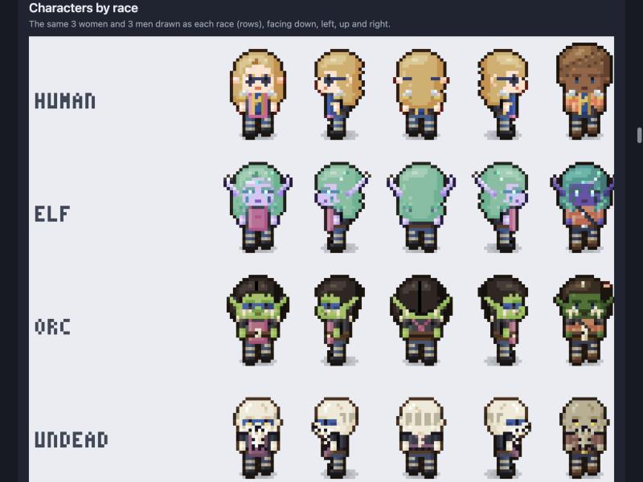

<p align="center">
  
</p>

<h1 align="center">Habblaud Fantasy</h1>

<p align="center">
  <b>A high-fantasy war camp for your Claude Code (and Codex) agents.</b><br />
  Every project becomes a department in a race's hall, and every agent a pixel-art human, orc, night elf or undead
  who shows, in real time, what it is doing.
</p>

<p align="center">
  
  
  
  
  
</p>

<p align="center">
  
</p>

---

You open Claude Code in several projects, launch subagents, leave tasks running… and lose track of who is doing
what. **Habblaud Fantasy** turns all of that into a living fantasy camp you can take in at a glance: who is typing,
who raised a hand because they **need you**, who delivered their work and left, who wandered off to the tavern while
waiting for the next instruction, and how much of each account you have used in the 5-hour session and in the week.

It is a fork of [Habblaud](https://github.com/marmottajr/habblaud) by marmottajr, redrawn from the ground up as a
fantasy world: four races, each with its own hall, land, furniture, names and look. Everything runs on your machine,
reading the files Claude Code itself already writes. Nothing leaves the computer: it doesn't read credentials and
makes no external calls besides an optional update check.

## Contents

- [The camp](#the-camp)
- [Installation](#installation)
- [Using it](#using-it)
- [Configuration](#configuration)
- [Development](#development)
- [Privacy and security](#privacy-and-security)
- [Credits and license](#credits-and-license)

## The camp

### Four races, four wings

Each project is given a race from its name, and its room joins that race's wing. The wings branch off a stone
square next to the core (the Great Hall, the Mess Hall, the Bathhouse and the Tavern):

| Race | Where | The hall | The land around it |
| --- | --- | --- | --- |
| **Humans** | west, along the main corridor | ashlar floors, blue and gold banners, a crenellated stone wall | a green park of oaks and pines |
| **Orcs** | east, across the square | rough flagstones, war paint, horned skulls, a palisade of sharpened stakes | cut-down badlands: sand, stumps, felled logs, thorn bushes |
| **Night elves** | north, up a covered walkway | moonwood floors, leaf banners, the hollow heart of a world tree | a jungle of vine-wrapped giants and ferns |
| **Undead** | south, down a covered walkway | crypt slabs glowing violet, bone furniture, Halloween all year, an iron graveyard fence | dead purple blight with bare trees and gravestones |

Every hall sits in the middle of its own land, and the lands meet roughly halfway between the halls in winding,
frayed borders, so the grounds melt into each other.

<table>
  <tr>
    <td width="50%"></td>
    <td width="50%"></td>
  </tr>
  <tr>
    <td width="50%"></td>
    <td width="50%"></td>
  </tr>
</table>

### Open-plan halls that grow

A wing is one hall with a **department per project**, not a row of boxes. Neighbouring projects share the floor, with
tall plants marking where one department ends, and the hall runs out to a **rounded outer wall** in the race's style,
where the departments' whiteboards, clocks, posters and windows hang. A department **grows with its team**: when more
agents work on a project than it has desks, it widens by another desk island (up to four), and it shrinks back once
the crowd is gone. When a new project joins a wing, the departments further out move over one at a time.

### People of the camp

Agents look like the race of their hall, each with several faces and hairstyles per race and gender: humans in
Alliance tabards, orcs with tusks, war paint and spiked shoulders, night elves with long ears, glowing eyes and
leaf-blade shoulders, and stooped undead skeletons with glowing sockets and an exposed ribcage. They get names of their
race, too.

<p align="center">
  
</p>

### What each character is doing

- **Typing at the desk:** the agent is working; the bubble over its head says what (reading a file, running a
  command, searching the web…).
- **Hand raised, with a "needs you" badge:** a permission request or a question is waiting for you. You can answer it
  from the camp (see [Answering from the camp](#answering-from-the-camp)).
- **Subagents:** they arrive with a badge, work next to the main agent and hand over their result when they are done.
- **Waiting on a long command:** an hourglass over the head, popcorn on the desk; cobwebs grow if it takes a while.
- **Idle:** agents with nothing to do have a social life: they play, gossip in the Mess Hall, freshen up and bet
  coins on rock-paper-scissors, each with its own personality.
- **Done:** the agent delivers its work and leaves; a hall's lights go out when its last agent leaves.

The day follows your clock (night falls with lanterns lit), seasonal dressing appears around Halloween and Christmas,
and a timelapse can replay a whole day.

## Installation

### Requirements

- **macOS** (tested) or Linux.
- **[Claude Code](https://code.claude.com)** with one or more accounts (2.1.287 or newer for the mod).
- **Node.js 22.12+** and **npm**.
- **Docker Desktop** (or Docker Engine with Compose v2), if you want to run it in a container.

### 1. Get the project

```bash
git clone https://github.com/Moeinich/habblaud-fantasy.git
cd habblaud-fantasy
npm install
```

`npm install` only downloads build tools (Vite, TypeScript, tsx…). The server has no runtime dependencies: it uses
only Node's built-in modules.

### 2. Start it

**Docker (recommended for keeping it always on):**

```bash
npm run docker:up
```

The script detects your Claude Code accounts, mounts only the folders it needs (read-only), builds the image and
starts the container, which restarts along with Docker. Open **http://localhost:4747**.

**Node, without Docker:**

```bash
npm run build
npm start
```

Open **http://localhost:4747**. Then open Claude Code in any project and watch your agent walk into its hall.

### 3. Install the mod in Claude Code (recommended)

```bash
npm run mod:install                          # the mod and the permission and message plugins, in every account
npm run mod:install -- --sem-permissoes      # without answering permissions and questions from the camp
npm run mod:install -- --sem-mensagens       # without sending messages to the agents from the camp
```

The [mod](https://code.claude.com/docs/en/plugins/mods/overview) runs inside each Claude Code session and is installed
through `claude plugin` itself, from this folder. With it:

- each account's **5-hour and weekly usage** shows up live;
- the terminal shows a line when **another session needs you**;
- the **`/habblaud`** command becomes available in Claude Code;
- you can **approve or deny permission requests** and **answer the agent's questions** from the camp;
- you can **send messages** to an agent as if you were typing in its terminal.

Sessions that are already open load the mod with `/reload-plugins`. Check with `npm run mod:status`; undo with
`npm run mod:uninstall`. The mod is loaded from this folder: if you move it, run `npm run mod:install` again. What the
mod can access is listed in [`mod/README.md`](mod/README.md).

<details>
<summary><b>Claude Code older than 2.1.287</b></summary>

Without mods, live usage and answering from the camp come from two installers that edit each account's
`settings.json` (with a backup first):

```bash
npm run usage:install    # puts a tap in front of each account's statusline to capture 5-hour/weekly usage
npm run hooks:install    # adds the PermissionRequest hook, to answer permissions from the camp
```

Undo with `npm run usage:uninstall` and `npm run hooks:uninstall`. Once you update Claude Code, switch to the mod:
`npm run mod:install` removes the old tap and hook.

</details>

### 4. Codex (optional)

Sessions of OpenAI's **Codex** (the `codex` CLI or the app) join the same camp, in the same department as Claude Code
when both are open in the same project, marked with a **CODEX** tag. The Codex folder is found on its own
(`~/.codex`, `CODEX_HOME` or `~/.codex*`). To see Codex live and approve its commands from the camp:

```bash
npm run codex:install      # adds the hooks to ~/.codex/hooks.json (backup first; other hooks stay)
npm run codex:status
```

Then open Codex and approve the new hooks in `/hooks`. In Docker, keep `npm run codex:bridge` running on the host to
send messages to Codex sessions.

### More

- **On your phone:** `npm run remote:setup` sets up a login and HTTPS so you can watch the camp and approve requests
  from your phone.
- **Several machines:** one camp can show the sessions of other machines (`HABBLAUD_INGEST=1` on the server,
  `npm run ingest:token` for a token and `npm run remote:install` on each machine).
- **Updating:** `git pull`, then `npm run docker:up` (or `npm run build && npm start`).
- **Uninstalling:** `npm run mod:uninstall` (and `codex:uninstall`, `usage:uninstall`, `hooks:uninstall` if you used
  them), `npm run docker:down`, then delete the folder and `~/.habblaud`.

## Using it

- **The sidebar** lists the projects and their agents; click one to fly to it. **The top bar** shows the counters
  and each account's 5-hour and weekly usage. **The activity feed** at the bottom narrates what is happening.
- **Click an agent** for its details: tasks, subagents, a timeline, statistics and the live terminal.
- <a id="answering-from-the-camp"></a>**Answering from the camp:** when an agent raises its hand, its request shows up
  in a card; approve, deny or answer the question right there.
- **Sending messages:** type to an agent from its details panel; the message reaches its session as if typed in its
  terminal.
- **Editing a character:** change an agent's look and name from its details panel.
- **Languages:** the interface is in English, Spanish and French; it follows your browser or the choice in
  Settings › Language.
- **Demo mode:** `npm run demo` (or `HABBLAUD_DEMO=1`) fills the camp with simulated agents, handy to look around.

## Configuration

Everything works without configuration. Adjust with environment variables when needed:

| Variable | Default | What for |
| --- | --- | --- |
| `HABBLAUD_PORT` | `4747` | HTTP port (in Docker, the port published on the host). |
| `HABBLAUD_HOST` | `127.0.0.1` | Server interface in Node mode. Anything other than a local address turns off the terminal and acting on sessions. |
| `HABBLAUD_BIND` | `127.0.0.1` | Docker only: where the port is published. `0.0.0.0` opens it to the network (and turns off the terminal). |
| `HABBLAUD_CLAUDE_DIRS` | detected | Claude Code account folders, comma-separated. |
| `HABBLAUD_DATA_DIR` | `~/.habblaud` | Where the camp keeps its own data (character and room names, the timelapse, statistics). |
| `HABBLAUD_TIMELINE` | on | `0` turns off timeline recording for the timelapse. |
| `HABBLAUD_USAGE_DIR` | `~/.habblaud/usage` | Where the mod writes usage. |
| `HABBLAUD_DEMO` | off | `1` starts in demo mode. |
| `HABBLAUD_STALE_MINUTES` | `10` | A session quiet this long leaves the office (30 min if it reports busy). `0` = never. |
| `HABBLAUD_ACCOUNT_IDLE_HOURS` | `24` | An account unused this long is hidden from the top bar and filters. `0` = always show. |
| `HABBLAUD_ALLOWED_HOSTS` | — | Extra host names accepted in the address, besides `localhost` and IPs. |
| `HABBLAUD_TERMINAL` | on (local only) | `0` turns off the terminal, answering and messages from the camp, and the character editor. |
| `HABBLAUD_PTY` | off | `1` turns on the interactive terminal (open, take over and end sessions) and **New agent**. Local access only. |
| `HABBLAUD_CLAUDE_BIN` | `claude` | The Claude Code executable for the interactive terminal and New agent. |
| `HABBLAUD_REMOTE_ALLOW` | `permissions` | What the phone login may do: `permissions`, `messages`, `terminal`, `spawn` or `none`. |
| `HABBLAUD_INGEST` | off | `1` lets other machines send their sessions here (remote HTTPS port only). |
| `HABBLAUD_SERVER_URL`, `HABBLAUD_SERVER_TOKEN` | — | On a machine that sends its sessions to another camp: the server address and this machine's token. |
| `HABBLAUD_MENSAGENS` | on (with the terminal) | `0` turns off only sending messages from the camp. |
| `HABBLAUD_CODEX` | on | `0` leaves Codex out. |
| `HABBLAUD_CODEX_DIRS` | detected | Codex folders, comma-separated. |
| `HABBLAUD_CODEX_BIN` | `codex` | The Codex binary that delivers messages. |
| `HABBLAUD_UPDATE_CHECK` | on | `0` turns off the new-version check. |
| `HABBLAUD_LANG` | system language, else `en` | Language of texts built by the server (activities, notices, logs): `en`, `es` or `fr`. |
| `HABBLAUD_BRAND_NAME` | `Habblaud` | White-labeling: the name in the page title, the pixel logo, the home-screen app and the login page (1–24 characters; a `|` sets where the gold part of the logo starts, e.g. `swift|c`). |
| `HABBLAUD_BRAND_SHORT` | the brand name | Short label under the home-screen icon. |
| `HABBLAUD_ACCOUNTS` | — | JSON to customize an account's name, letter or color, e.g. `[{"id":".claude-work","name":"Work","short":"W","color":"#5cc97b"}]`. |

On a TV or other weak device, open the page with `?lite=1` (TV browsers get it automatically): 30 fps at most and no
blur behind the panels. `?fps=` sets the frame rate on any device.

In Docker, put these in `.env`. `npm run docker:up -- --no-build` starts without rebuilding, `npm run docker:down`
stops and `npm run docker:logs` follows the logs.

## Development

| Command | What it does |
| --- | --- |
| `npm run dev` | Server + Vite at http://localhost:4747, with hot reload. |
| `npm run dev:client` | Vite only, at http://localhost:5173 (open it with `?mock=1`). |
| `npm run demo` | `npm run dev` with demo mode on. |
| `npm run build` / `npm start` | Builds and runs the production version. |
| `npm test` | Tests (Vitest). |
| `npm run typecheck` | Type checking for the client, the server and the scripts. |
| `npm run i18n:check` | Lists untranslated and leftover Spanish/French texts; fails on Portuguese text in the code. |

The art lives in `client/src/art` (characters, furniture, floors, rugs, all drawn procedurally) and the world in
`client/src/world` (layout of the wings and halls, the simulation, rendering, the elf tree, the hall rings and the
lands). `client/art-preview.html` (served at `/art-preview.html` in dev) shows every piece of art, including the
characters of each race. In the browser console, `habblaud.world.debug` has helpers for testing scenes, for example
`habblaud.world.debug.setHour(21)` for the night or `habblaud.world.debug.spawnSession({ project: 'name' })` to add an
agent.

Every visible string goes through `tr('English text')`; Spanish and French translations live in `shared/locales/`.
Every visible change gets an entry under "Unreleased" in [`CHANGELOG.md`](CHANGELOG.md). See
[`CONTRIBUTING.md`](CONTRIBUTING.md) for the rest.

## Privacy and security

- **Read-only:** the camp never writes to the Claude Code folders; only the installers you run do (always with a
  backup first).
- **Local by default:** the server only accepts connections from the computer it runs on. There is no telemetry; the
  only external call is the optional new-version check (`HABBLAUD_UPDATE_CHECK=0` turns it off).
- **No credentials:** it doesn't read passwords or access tokens, and tokens in known formats are masked (`***`)
  before they reach the browser.
- **Protected against malicious sites:** addresses that aren't `localhost`/IP (DNS rebinding) and cross-origin
  `POST` requests (CSRF) are refused, and the page can't be embedded in other sites.
- **Local-only terminal:** conversations and anything that acts on your sessions are only available when the camp is
  reachable only from the computer it runs on.

## Credits and license

Habblaud Fantasy is a fork of [Habblaud](https://github.com/marmottajr/habblaud) by marmottajr, released under the MIT
license; this fork keeps the same [license](LICENSE). Habblaud Fantasy is an independent project, not affiliated with
or endorsed by Anthropic, OpenAI or any game publisher.
